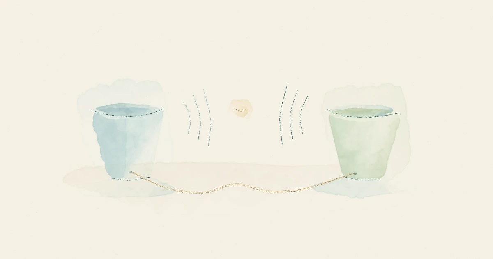
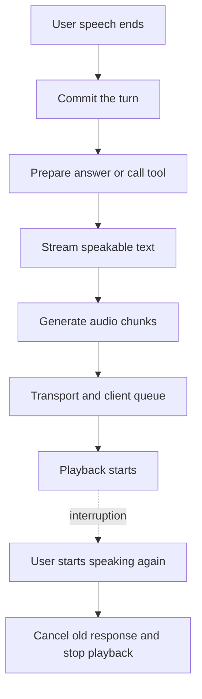

# A voice assistant has more than one latency problem



A voice assistant can start generating a response quickly and still feel slow. It can also answer quickly and feel rude, because it keeps cutting off the person speaking.

Both problems can get described as “latency.” They need different fixes.

Before changing a model, I would want to know where the conversation is waiting: for the assistant to decide I have finished, for an answer to be prepared, for audio to reach my ears, or for the assistant to stop talking when I interrupt.

This article follows a speech-to-text, language-model, text-to-speech pipeline. A speech-to-speech system exposes different internal boundaries, but the questions at the user's end still apply. The [companion trace analyzer](https://github.com/subodhjena/voice-latency-lab) uses invented timelines to make those boundaries visible. It does not call a model or measure a provider.

## Start with the wait the person experiences

“Time to first token” starts when a language-model request starts. The person speaking may already have waited through a silence threshold, transcription, a tool lookup, and a queue before that request exists.

Likewise, a speech service returning its first audio bytes does not mean the person has heard them. Those bytes still have to travel, be decoded, enter the playback queue, and reach an output device.

I would name the boundaries before discussing a target:

| Question                                  | Start                       | End                        | What it helps diagnose                |
| ----------------------------------------- | --------------------------- | -------------------------- | ------------------------------------- |
| How long did we wait to take the turn?    | Observed end of user speech | Turn committed             | Endpointing and transcript readiness  |
| How quickly did the model start?          | Model request started       | First response token       | Model and request overhead            |
| How quickly did speech generation start?  | Speakable text submitted    | First audio produced       | TTS startup                           |
| How long did received audio wait?         | Audio received at client    | Playback started           | Client buffering and scheduling       |
| How long until an answer started playing? | Observed end of user speech | First response playback    | The response path as a whole          |
| How long until useful content played?     | Observed end of user speech | First task-relevant speech | Acknowledgments masking a longer wait |
| How quickly did it yield?                 | User interruption began     | Assistant playback stopped | Interruption handling                 |

These are definitions for an investigation, rather than interchangeable vendor metrics. For example, “first audio” might mean a generated chunk, an arriving packet, or a playback event. A dashboard should say which one it records.

## Deciding that someone has finished takes time

Consider this request:

> “Move the appointment to Friday ... actually, Monday morning.”

The pause matters. Taking the turn after “Friday” is faster on a timer and worse for the task.

Voice activity detection answers whether the audio contains speech. It does not, by itself, establish that a request is complete. [LiveKit's turn-detection guide](https://livekit.com/blog/turn-detection-voice-agents-vad-endpointing-model-based-detection) separates voice activity, endpointing, and semantic completion. Those signals can disagree: the audio can be quiet while the sentence remains unfinished.

I would test an endpointing change against both premature responses and unnecessary waits. Include people pausing to find a reference, spelling a name, giving a long number, correcting themselves, and speaking over background noise. A setting that improves clean, short questions might damage those conversations.

Human turn-taking research is useful context, but it does not supply a universal product deadline. [Stivers and colleagues](https://doi.org/10.1073/pnas.0903616106) studied question-response sequences across ten languages. They found a general tendency to minimize gaps and overlap, alongside variation between languages and kinds of response. That is a reason to test conversational timing with the intended users, rather than copy one number into every application.

## Follow the critical path through the pipeline

Here is a simplified response path. Transcription can already be running while the person speaks. Text generation and speech synthesis can overlap after enough text is ready.



The diagram describes dependencies. It does not mean every component consumes a separate, non-overlapping slice of time.

Adding a complete transcription duration, a complete generation duration, and a complete synthesis duration can double-count overlapping work. The elapsed time between the two user-facing boundaries is the measurement to explain. Component spans help locate the cause.

This also changes how I would read a research result. The [FireRedChat paper](https://arxiv.org/html/2509.06502v1) evaluates barge-in, end-of-turn detection, and latency separately. Its latency section describes its particular pipeline and experimental conditions. Those measurements do not establish what a browser on a different network will hear. The useful part for this investigation is the separation of concerns, not a number to promise elsewhere.

### Streaming introduces a text-buffer decision

An early token may be an opening quote, an incomplete amount, or the beginning of a sentence that is about to change direction. It is not necessarily ready to speak.

Waiting for a full response can waste time. Sending every fragment immediately can produce awkward phrasing, unreliable pronunciation, or speech that gets ahead of a tool result. I would instrument when the first usable text segment becomes available and when it is submitted to TTS. That exposes buffering which otherwise gets blamed on synthesis.

A short acknowledgment can be useful during a genuine lookup. It should also have its own label. “Let me check” at 400 ms followed by the actual answer at two seconds describes two events. Counting only the first makes it too easy to improve the chart without improving the wait.

## Three traces, the same model time

The companion contains three synthetic turns. All three use a model time to first token of 180 ms and a TTS startup of 110 ms. Their user-facing timings differ:

| Synthetic turn    | Endpoint wait | Client queue | First playback | Useful playback | Stop after interruption |
| ----------------- | ------------: | -----------: | -------------: | --------------: | ----------------------: |
| Baseline          |        250 ms |        60 ms |         680 ms |          680 ms |                   90 ms |
| Late endpoint     |        700 ms |        60 ms |       1,130 ms |        1,130 ms |                   90 ms |
| Buffer and filler |        250 ms |       430 ms |       1,050 ms |        1,700 ms |                  350 ms |

In the second turn, the extra wait happens before the model request. In the third, audio sits at the client and the first thing played is filler. Changing the model's startup time would leave both of those causes in place.

The analyzer calculates intervals directly. This is the relevant part of its boundary map:

```python title="latency.py"
PAIRS = {
    "endpoint_ms": ("user_end", "turn_committed"),
    "llm_ttft_ms": ("llm_start", "first_token"),
    "tts_first_audio_ms": ("tts_text_ready", "tts_first_audio"),
    "client_queue_ms": ("audio_received", "playback_started"),
    "first_playback_ms": ("user_end", "playback_started"),
    "useful_playback_ms": ("user_end", "useful_playback"),
    "stop_ms": ("barge_in", "playback_stopped"),
}
```

Run the complete example with Python 3.11 or later, without packages or API keys:

```bash
python3 -m unittest -v
python3 latency.py
```

Eight tests check the different waits, missing events, duplicate events, invalid timestamps, mixed clocks, and cumulative jitter-buffer counters. The [tested code revision](https://github.com/subodhjena/voice-latency-lab/tree/4d92e263446447f5d9ef99344247b60db4fc881e) includes the fixtures and captured output. The values were constructed to explain the arithmetic; they are not proposed latency budgets.

## Put timestamps where the events happen

Server logs alone cannot establish when a person stopped speaking or heard an answer. I would collect client observations alongside server and provider spans, linked by session, turn, and response identifiers.

Clock domains need explicit treatment. A browser's monotonic clock and a server's monotonic clock do not share an origin. Subtracting their raw timestamps can create a plausible-looking, meaningless duration. Keep local intervals local. For cross-machine analysis, document the synchronization or mapping method and its uncertainty. The companion assumes normalization has already happened and rejects mixed clock labels; it does not solve clock synchronization.

A playback callback is also an observation with limits. It may show scheduling or rendering, rather than acoustic output at the speaker. If the acoustic boundary matters, validate it with a controlled audio capture or loopback experiment and document the device path.

### Inspect buffering without misreading the counters

The [WebRTC statistics specification](https://www.w3.org/TR/webrtc-stats/#dom-rtcinboundrtpstreamstats-jitterbufferdelay) defines `jitterBufferDelay` as accumulated sample or frame residence time, in seconds. It is not the current queue length. For two samples of the same inbound statistics object, an interval average can be calculated as:

```text
mean jitter-buffer residence in ms =
  1000 × change in jitterBufferDelay
       / change in jitterBufferEmittedCount
```

Use a new window if the object changes or counters reset. If nothing was emitted, the average is unknown. This value describes the jitter buffer, not the entire client queue or the device's acoustic delay.

Network placement is another part of the trace. [LiveKit's pipeline latency guidance](https://kb.livekit.io/articles/4490830410-how-can-i-reduce-latency-in-voice-pipeline-agents-using-stt-tts-and-llm) calls out proximity between the agent and its speech and language services. I would measure that route before assuming the nearest application server also has the shortest path to every provider.

## Measure how quickly it stops

An assistant that answers promptly but talks over a correction still feels unresponsive.

For interruption tests, I would record the user's speech onset, detection, cancellation request, and playback stop. A cancellation acknowledgment from the server is an intermediate event. Audio may already be in transit or queued locally.

The implementation needs a way to invalidate the old response, stop queued playback, and ignore late chunks belonging to that response. Conversation history also needs to reflect the portion actually delivered. Otherwise the next answer may assume the user heard instructions that were canceled halfway through.

Test true interruptions alongside coughs, nearby speech, and the assistant's own audio leaking into the microphone. Stopping on every sound can be as disruptive as failing to stop. Record missed interruptions and false interruptions beside stop time, so a faster detector cannot hide a worse conversation.

## Choose the next change from the trace

I would keep a distribution of end-to-end waits, split by the conditions that change the work: tool use, long utterances, device route, network conditions, and interruption. Keep failed, abandoned, and timed-out turns visible. A latency chart containing only completed turns loses some of the worst experiences.

Do not add component p95 values to manufacture an end-to-end p95. The slowest component samples need not belong to the same turns. Calculate the end-to-end distribution from paired observations, then inspect its slow cases.

For the next change, I want one specific explanation: the turn was committed late; a lookup blocked the answer; text waited before synthesis; audio waited before playback; or canceled speech kept playing. Each explanation points to a different piece of engineering. That is a more useful starting point than asking which model is fastest.

---

Article snapshot prepared 17 October 2026. The [website article](https://subodhjena.com/blog/a-voice-assistant-has-more-than-one-latency-problem) is canonical; code and fixtures are maintained in this repository. Examples prepared and run on 17 October 2026.
